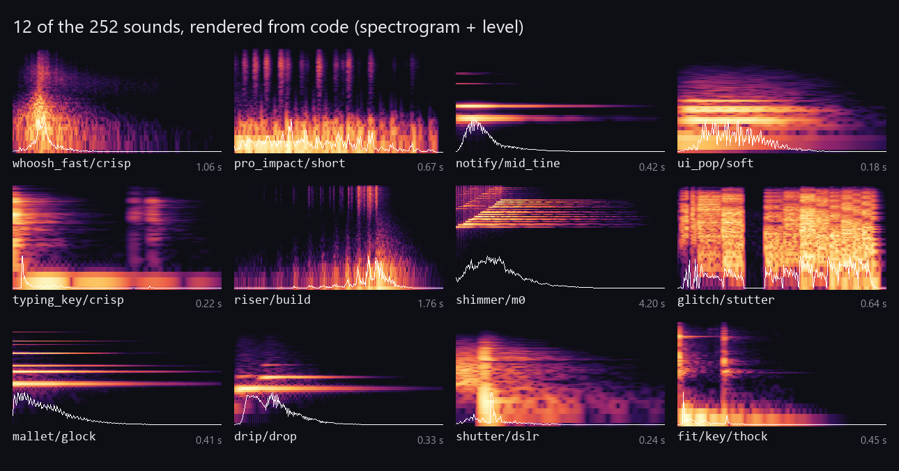
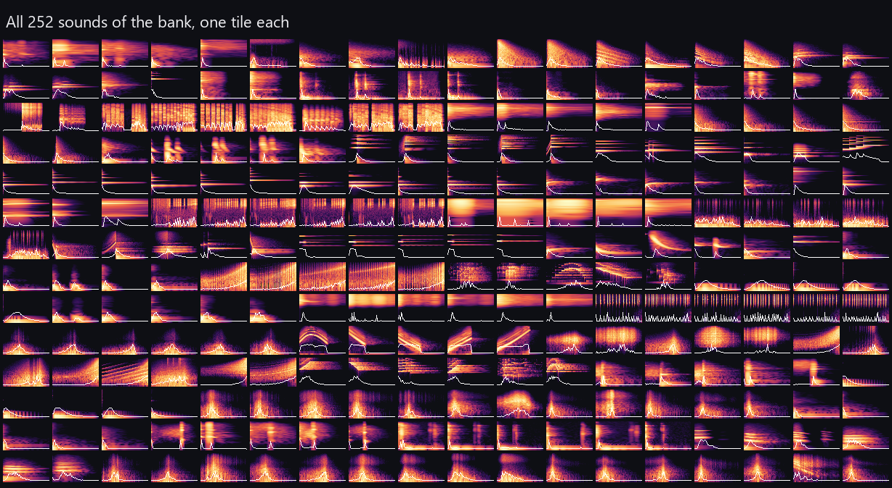

<div align="center">

# earshot-sfx-lite

**252 free sound effects for your app or video, rendered from code: whooshes, clicks, pops, dings. No samples, no torch.**

The sound bank of [earshot](https://github.com/Leonxlnx/earshot) (Leon Lin's "ears for coding agents") on its own: the same WAV files, byte for byte, with `numpy` and `scipy` instead of torch, transformers, librosa and ffmpeg.

Works with **Claude Code** and **Codex**.

 



<sub>Real output: `python -m sfxlite export out/all`, drawn by `python tools/gallery.py out/all docs`. Bright = loud; the white line is the level.</sub>

</div>

## Quick start
```bash
git clone https://github.com/Dodai0419/earshot-sfx-lite && cd earshot-sfx-lite && pip install -r requirements.txt
python -m sfxlite render whoosh_fast/crisp -o whoosh.wav
```
```
wrote whoosh.wav: whoosh_fast/crisp seed 420116625: 1.056 s, onset 0.019 s, peak at 0.131 s, end 0.681 s, -1.0 dBFS, -15.1 LUFS momentary max; checks: clean
```
Optional: `pip install numba` makes renders faster (a cold `render click/soft`: 15.6–18.6 s without, 6.6–8.3 s with) and changes no byte of the output.

Listen first: [whoosh](docs/samples/whoosh_fast__crisp.wav) · [UI pop](docs/samples/ui_pop__soft.wav) · [notification](docs/samples/notify__mid_tine.wav) · [key press](docs/samples/typing_key__crisp.wav) · [impact](docs/samples/pro_impact__short.wav) · [glockenspiel](docs/samples/mallet__glock.wav)

## Gallery
Every sound in the bank, one spectrogram each (44 categories, 252 sounds):



| You need | Ask for | Example |
|---|---|---|
| A cut or a slide | `whoosh_fast/*`, `swish/*`, `swipe/*`, `whoosh_big/*` | `render whoosh_fast/crisp -o w.wav` |
| A reveal | `riser/*`, then `pro_impact/*` or `sub_drop/*` | `render riser/build -o r.wav --dur 2.0` |
| A button, a toggle, a hover | `click/*`, `pro_click/*`, `toggle/*`, `hover_tick/*`, `tap/*` | `render toggle/latch -o t.wav` |
| Something arriving | `ui_pop/*`, `pro_pop_in/*`, `pop/*`, `drip/*` | `render ui_pop/soft -o p.wav --pitch A4` |
| A message | `notify/*`, `pro_notify/*`, `mallet/*` | `render mallet/glock -o m.wav --pitch E6` |
| Typing on screen | `typing_key/*`, `pro_typing_run/*`, `fit/key/*` | `render fit/key/thock -o k.wav` |
| A logo at the end | `logo_sting/*`, `pro_logo_sting/*`, `shimmer/*` | `render shimmer/m0 -o s.wav` |
| Glitch and camera moves | `glitch/*`, `pro_glitch/*`, `shutter/*`, `reverse_swell/*` | `render shutter/dslr -o c.wav` |

`python -m sfxlite list` prints every id with its length, peak time, cue kinds and which knobs it takes. `--kind whoosh`, `--kind hit` or `--kind key` narrows it.

### Aim a sound at the picture
The knobs edit the recipe's own parameters (they never resample), exactly like `earshot sfx render`:
```bash
python -m sfxlite render whoosh_fast/crisp -o w.wav --dur 0.8 --apex 0.32   # 0.8 s long, loudest at 0.32 s
python -m sfxlite render mallet/glock -o ding.wav --pitch E6                 # tuned through the recipe
python -m sfxlite render click/soft -o c2.wav --seed 7                        # a new take, same character
```
```
wrote w.wav: whoosh_fast/crisp seed 420116625: 0.800 s, onset 0.053 s, peak at 0.321 s, end 0.650 s, -1.0 dBFS, -17.6 LUFS momentary max; apex 0.320 s (measured 0.321, +0 ms); dur 0.800 s (shape, trim 21 ms (fade 150 ms)); checks: clean
wrote ding.wav: mallet/glock seed 1: 0.421 s, onset 0.000 s, peak at 0.025 s, end 0.335 s, -1.0 dBFS, -12.2 LUFS momentary max; pitch E6 (measured 1318.5 Hz); checks: clean
```

### The whole pack, and an audit
```bash
python -m sfxlite export sfx/                 # 252 WAVs, 24-bit / 48 kHz, named <category>__<member>.wav
python -m sfxlite export sfx/ --kind whoosh   # only the 35 whooshes
python -m sfxlite check my_sound.wav          # clicks, cut tails, clipping, DC, ring, rising pitch glide
```

## The problem
- earshot makes very good sound effects, but `pip install` pulls torch, transformers, librosa, scikit-learn and matplotlib, and its README asks for ffmpeg, because the same package also listens to audio with two neural models.
- If you only want the sounds (for an app, a game jam or a launch video), that is a lot to install on a laptop, a CI runner or a container.
- Shipping WAV files instead loses the knobs: exact length, apex time, pitch and new takes.

## The solution
| Idea | Fixes |
|------|-------|
| **Keep only the rendering half** of earshot (bank, recipes, DSP, fitted models, knobs, audit) | 2 required packages instead of 11 + ffmpeg |
| **Rewrite the audio I/O** with the standard library, matching libsndfile's 24-bit conversion | Same WAV bytes as earshot without soundfile or ffmpeg |
| **Same commands and output lines** as `earshot sfx list / render / check`, plus `export` | Agents and scripts written for earshot keep working |

## Use with Claude Code
```bash
/plugin marketplace add Dodai0419/earshot-sfx-lite
/plugin install earshot-sfx-lite@earshot-sfx-lite
```
Then ask: "add a soft pop when a card appears and a whoosh on each slide change".

## Use with Codex (ChatGPT)
```bash
git clone https://github.com/Dodai0419/earshot-sfx-lite && cp -r earshot-sfx-lite/skills/* ~/.codex/skills/
```
Or copy `AGENTS.md` into your project root.

## Same output as earshot
`tests/upstream_sha256.json` holds the SHA-256 of every WAV that earshot 0.4.0 (commit `591fa3e`) wrote with `earshot sfx render`.

| Check | Result |
|---|---|
| All 252 sounds, default settings (`SFXLITE_FULL=1 python -m unittest`) | **252 / 252 byte-identical** |
| Knob settings (dur + apex, pitch, seed, weight, a fitted sound with seed + dur) | **8 / 8 byte-identical** |
| Without numba (pure numpy / scipy path) | 10 of 10 sounds tried byte-identical (the full run takes hours without numba) |

The hashes hold for the versions in `requirements.txt` (numpy 2.4.6, scipy 1.17.1). With other versions a sample can move by one 24-bit step, for earshot as much as for this repo, so the tests then fall back to earshot's own re-render check (length exact, peak within 5 ms, envelope within 0.5 dB).

Two details were needed for identical files: libsndfile turns a float into 24 bits by rounding to 32 bits and dropping the low byte (a floor, not a rounding), and it pads an odd-length mono chunk with one byte. Both are in `sfxlite/audio.py` and have their own tests.

## Benchmarks
Windows 11, Python 3.11.1, numpy 2.4.6, scipy 1.17.1, numba 0.68.0, on a machine that was busy with other work. Upstream is earshot 0.4.0, commit `591fa3e`, run with the same packages.

| | earshot 0.4.0 | earshot-sfx-lite |
|---|---|---|
| required packages | 11 (`numpy scipy soundfile soxr librosa pyloudnorm scikit-learn pillow matplotlib torch transformers`) + ffmpeg | **2** (`numpy scipy`); numba optional |
| torch wheel alone (cp311, Windows, PyPI) | 124 MB | not needed |
| installed size of the venv | not measured | **220 MB** (numpy + scipy), 373 MB with numba |
| Python in the package | 33,768 non-blank lines, 84 files | **20,760** non-blank lines, 52 files (-39%) |
| one sound from a cold start (`render click/soft`, numba) | 8.8–10.7 s | **6.6–8.3 s** |
| 32 sounds in one process (numba) | 30.3–32.7 s | 32.3–32.9 s (same code, same speed) |
| one sound without numba (`render click/soft`) | not measured (same code path) | 15.6–18.6 s |

How to reproduce: time `python -m earshot sfx render click/soft -o a.wav` in an earshot checkout and `python -m sfxlite render click/soft -o b.wav` here, then `cmp a.wav b.wav`. Render times are dominated by imports and numba's cached kernels on this machine; on an idle one both columns will be faster.

## Inspired by
- [Leonxlnx/earshot](https://github.com/Leonxlnx/earshot) (MIT): every recipe, the DSP toolkit, the fitted models, the knobs, the audit and the sound bank in `sfxlite/` come from earshot 0.4.0, renamed from `earshot.forge` to `sfxlite.forge`. The fitted `fit/*` sounds are models of CC0 recordings ([docs/CREDITS_FIT.md](docs/CREDITS_FIT.md)).

## Roadmap
- [ ] `export --format ogg` for web apps (without ffmpeg)
- [ ] A browser page that previews and downloads any sound
- [ ] Follow new earshot banks (re-run the byte comparison on each release)

## License
MIT. The code and sound bank from earshot keep Leon Lin's copyright (see `LICENSE` and `NOTICE`).
